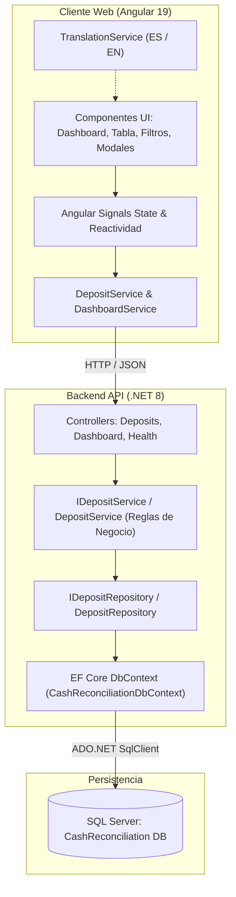

<p align="right">
  <a href="README.md">🇺🇸 English</a> | 🇪🇸 Español
</p>

# Cash Reconciliation Portal (Portal de Conciliación de Efectivo)

> 🚀 **Demostración en Vivo / Online**: Puede ejecutar y probar la aplicación directamente en línea en la siguiente dirección:  
> **[https://javtekoficial.github.io/Cash-Reconciliation-Portal/](https://javtekoficial.github.io/Cash-Reconciliation-Portal/)**

---

Sistema integral de nivel empresarial para la gestión, recepción y conciliación de bolsas de depósito de efectivo provenientes de tiendas en una bóveda central. Desarrollado con una arquitectura desacoplada y moderna que incluye **ASP.NET Core Web API (.NET 8)**, **Entity Framework Core 8**, **SQL Server** y un cliente web en **Angular 19** con soporte nativo multilingüe (**Español** e **Inglés**).

---

## Tabla de Contenidos

1. [Descripción General y Objetivos](#descripción-general-y-objetivos)
2. [Stack Tecnológico](#stack-tecnológico)
3. [Arquitectura del Sistema](#arquitectura-del-sistema)
4. [Reglas de Negocio](#reglas-de-negocio)
5. [Requisitos Previos](#requisitos-previos)
6. [Instalación y Configuración](#instalación-y-configuración)
   - [Configuración de la Base de Datos](#1-configuración-de-la-base-de-datos)
   - [Ejecución del Backend (.NET 8 API)](#2-ejecución-del-backend-net-8-api)
   - [Ejecución del Frontend (Angular 19)](#3-ejecución-del-frontend-angular-19)
7. [Documentación de la API REST](#documentación-de-la-api-rest)
8. [Ejecución de Pruebas Automatizadas](#ejecución-de-pruebas-automatizadas)
9. [Internacionalización y Soporte Multilingüe](#internacionalización-y-soporte-multilingüe-i18n)
10. [Estructura del Proyecto](#estructura-del-proyecto)
11. [Historial de Commits en Git](#historial-de-commits-en-git)

---

## Descripción General y Objetivos

El portal resuelve la necesidad operativa de control y auditoría de ingresos de efectivo en bóvedas centrales:
* **Recepción y Registro**: Captura de depósitos con número único de bolsa, número de tienda, monto esperado declarado y fecha.
* **Conteo y Conciliación**: Ingreso del conteo físico real con cálculo dinámico en vivo de la varianza antes del guardado.
* **Auditoría Automatizada**: Clasificación inmediata en estados *Conciliado*, *Sobrante* o *Faltante* según la diferencia detectada.
* **Panel de Control (Dashboard)**: Métricas consolidadas en tiempo real (total de depósitos, pendientes, conciliados, faltantes, sobrantes y varianza acumulada).
* **Búsqueda Avanzada y Filtros**: Búsqueda por número de depósito, número de tienda, estado y rango de fechas.
* **Experiencia de Usuario Premium**: Interfaz moderna en tema claro (*light theme*) con *glassmorphism*, micro-animaciones, diseño completamente responsivo y cambio de idioma en caliente (ES/EN).

---

## Stack Tecnológico

| Capa | Tecnología | Versión | Propósito |
| :--- | :--- | :--- | :--- |
| **Backend API** | ASP.NET Core Web API | .NET 8 | API REST con controladores tradicionales e inyección de dependencias |
| **ORM / Datos** | Entity Framework Core | 8.0.11 | Acceso a datos relacionales, migraciones y Fluent API |
| **Base de Datos** | Microsoft SQL Server / Express | 2019/2022 | Almacén relacional con restricciones e índices optimizados |
| **Documentación API** | Swagger / OpenAPI | Swashbuckle 6.6.2 | Especificación interactiva de endpoints |
| **Frontend Web** | Angular | 19.1 | SPA con Standalone Components, Signals y Reactive Forms |
| **Estilos** | CSS3 Moderno | Custom tokens | Variables CSS, Glassmorphism, tema claro (*light theme*) y animaciones fluidas |
| **Testing Backend** | xUnit & Moq | 2.9 / 4.21 | Pruebas unitarias de servicios de negocio y lógica de conciliación |
| **Testing Frontend** | Jasmine & Karma | 5.5 / 6.4 | Pruebas unitarias de componentes, reactividad y traducciones |

---

## Arquitectura del Sistema

El sistema implementa una arquitectura por capas desacoplada basada en el **Patrón Repository**:



---

## Reglas de Negocio

### 1. Cálculo de la Varianza (Diferencia de Efectivo)
$$\text{Varianza} = \text{Monto Real Contado} - \text{Monto Esperado}$$

### 2. Clasificación Automática de Estados
* $\text{Varianza} = 0 \longrightarrow$ **Conciliado (`Reconciled`)**: El efectivo contado coincide con el monto esperado.
* $\text{Varianza} > 0 \longrightarrow$ **Sobrante (`Over`)**: Hay más dinero en la bolsa del que reportó la tienda.
* $\text{Varianza} < 0 \longrightarrow$ **Faltante (`Short`)**: Falta dinero en la bolsa respecto a lo reportado.

### 3. Validaciones de Integridad
* `DepositNumber`: Obligatorio, único en el sistema (índice único en base de datos).
* `StoreNumber`: Obligatorio (no nulo, longitud máxima 50 caracteres).
* `ExpectedAmount`: Mayor estrictamente a 0 (`> 0.00`).
* `ActualAmount`: Mayor o igual a 0 (`>= 0.00`) al momento de conciliar.
* `DepositDate`: Fecha válida del depósito.
* `ReconciledAt`: Fecha y hora UTC automática registrada al conciliar.

---

## Requisitos Previos

Antes de ejecutar la aplicación, asegúrese de tener instalado:
* [.NET 8 SDK](https://dotnet.microsoft.com/download/dotnet/8.0) (versión 8.0.x o superior).
* [Node.js](https://nodejs.org/) (versión 18.x o 20.x LTS) y `npm`.
* [Angular CLI](https://angular.dev/) (`npm install -g @angular/cli@19`).
* [Microsoft SQL Server](https://www.microsoft.com/sql-server/) (SQL Server Express, Developer o LocalDB).
* Herramientas globales de EF Core (opcional, para migraciones manuales):
  ```bash
  dotnet tool install --global dotnet-ef
  ```

---

## Instalación y Configuración

### 1. Configuración de la Base de Datos

1. Abra el archivo [BackEnd/appsettings.json](file:///c:/Users/Javie/Otros/Proyectos/Cash%20Reconciliation%20Portal/BackEnd/appsettings.json) y verifique la cadena de conexión:
   ```json
   {
     "ConnectionStrings": {
       "DefaultConnection": "Server=localhost\\SQLEXPRESS;Database=CashReconciliation;Trusted_Connection=True;TrustServerCertificate=True;MultipleActiveResultSets=true"
     }
   }
   ```
   *(Ajuste la instancia del servidor `Server=...` si su instalación de SQL Server difiere de `localhost\SQLEXPRESS`).*

2. Aplique las migraciones de Entity Framework Core para crear la base de datos, las tablas y sembrar los datos iniciales (*seed data*):
   ```powershell
   cd BackEnd
   dotnet ef database update
   ```

   **Datos iniciales sembrados automáticamente:**
   | Número Depósito | Tienda | Monto Esperado | Estado Inicial |
   | :--- | :--- | :--- | :--- |
   | `DEP1001` | `ST001` | $5,000.00 | Pending |
   | `DEP1002` | `ST002` | $4,250.00 | Pending |
   | `DEP1003` | `ST003` | $8,000.00 | Pending |
   | `DEP1004` | `ST004` | $1,200.00 | Pending |
   | `DEP1005` | `ST005` | $3,100.00 | Pending |

---

### 2. Ejecución del Backend (.NET 8 API)

1. En una terminal, navegue a la carpeta `BackEnd`:
   ```powershell
   cd BackEnd
   dotnet run --launch-profile http
   ```
2. La API estará disponible en:
   * **URL Base**: `http://localhost:5017`
   * **Swagger UI (Documentación interactiva)**: `http://localhost:5017/swagger`
   * **Health Check**: `http://localhost:5017/api/health`

---

### 3. Ejecución del Frontend (Angular 19)

1. En una segunda terminal, navegue a la carpeta `FrontEnd`:
   ```powershell
   cd FrontEnd
   npm install
   npm start
   ```
2. Abra su navegador web en:
   * **URL Portal**: `http://localhost:4200`

---

## Documentación de la API REST

### Endpoints Disponibles

| Método | Endpoint | Descripción | Códigos de Respuesta |
| :--- | :--- | :--- | :--- |
| `GET` | `/api/health` | Verificación de disponibilidad del servicio | `200 OK` |
| `GET` | `/api/deposits` | Listado paginado/filtrado de depósitos | `200 OK` |
| `GET` | `/api/deposits/{id}` | Obtener detalle de un depósito por su ID | `200 OK`, `404 Not Found` |
| `GET` | `/api/deposits/{id}/audit-logs` | Historial cronológico de auditoría (*Audit Trail*) | `200 OK`, `404 Not Found` |
| `GET` | `/api/deposits/export` | Exportar resultados de búsqueda a archivo CSV (UTF-8 BOM) | `200 OK` |
| `POST` | `/api/deposits` | Registrar un nuevo depósito en bóveda | `201 Created`, `400 Bad Request` |
| `PUT` | `/api/deposits/{id}/reconcile` | Conciliar depósito ingresando monto real | `200 OK`, `400 Bad Request`, `404 Not Found` |
| `GET` | `/api/dashboard` | Métricas consolidadas del dashboard (soporta filtros de búsqueda) | `200 OK` |

### Parámetros de Consulta y Filtro en `GET /api/deposits`

* `depositNumber` (string): Búsqueda parcial por número de depósito.
* `storeNumber` (string): Búsqueda parcial por tienda.
* `status` (string): Filtrar por estado (`Pending`, `Reconciled`, `Over`, `Short`).
* `startDate` (DateTime): Fecha mínima de depósito.
* `endDate` (DateTime): Fecha máxima de depósito.
* `pageNumber` (int, por defecto `1`, mín `1`): Número de página solicitada para paginación en servidor.
* `pageSize` (int, por defecto `10`, mín `1`, máx `100`): Cantidad de registros por página.

#### Estructura de Respuesta Paginada (`PagedResult<DepositDto>`)
```json
{
  "items": [
    {
      "depositId": 1,
      "depositNumber": "DEP1001",
      "storeNumber": "ST001",
      "expectedAmount": 5000.00,
      "actualAmount": 5000.00,
      "variance": 0.00,
      "status": "Reconciled",
      "depositDate": "2026-10-23T04:00:00",
      "reconciledAt": "2026-10-23T04:30:00",
      "createdAt": "2026-10-23T04:00:00"
    }
  ],
  "pageNumber": 1,
  "pageSize": 10,
  "totalCount": 25,
  "totalPages": 3,
  "hasPreviousPage": false,
  "hasNextPage": true
}
```

### Ejemplos de Peticiones y Respuestas

#### 1. Registrar Depósito (`POST /api/deposits`)
**Request Body:**
```json
{
  "depositNumber": "DEP1006",
  "storeNumber": "ST006",
  "expectedAmount": 2500.00,
  "depositDate": "2026-10-23T10:00:00Z"
}
```
**Response (`201 Created`):**
```json
{
  "depositId": 6,
  "depositNumber": "DEP1006",
  "storeNumber": "ST006",
  "expectedAmount": 2500.00,
  "actualAmount": null,
  "variance": null,
  "status": "Pending",
  "depositDate": "2026-10-23T10:00:00",
  "reconciledAt": null,
  "createdAt": "2026-10-23T04:29:36.955Z"
}
```

#### 2. Conciliar Depósito (`PUT /api/deposits/{id}/reconcile`)
**Request Body:**
```json
{
  "actualAmount": 2450.00
}
```
**Response (`200 OK`):**
```json
{
  "depositId": 6,
  "depositNumber": "DEP1006",
  "storeNumber": "ST006",
  "expectedAmount": 2500.00,
  "actualAmount": 2450.00,
  "variance": -50.00,
  "status": "Short",
  "depositDate": "2026-10-23T10:00:00",
  "reconciledAt": "2026-10-23T04:31:14.519Z",
  "createdAt": "2026-10-23T04:29:36.955Z"
}
```

#### 3. Consultar Registro de Auditoría (`GET /api/deposits/{id}/audit-logs`)
**Response (`200 OK`):**
```json
[
  {
    "auditLogId": 2,
    "depositId": 6,
    "action": "Reconciled",
    "previousActualAmount": null,
    "newActualAmount": 2450.00,
    "previousVariance": null,
    "newVariance": -50.00,
    "previousStatus": "Pending",
    "newStatus": "Short",
    "performedBy": "Operador de Bóveda",
    "notes": "Conciliación inicial de depósito",
    "timestamp": "2026-10-23T16:30:00.000Z"
  },
  {
    "auditLogId": 1,
    "depositId": 6,
    "action": "Created",
    "previousActualAmount": null,
    "newActualAmount": null,
    "previousVariance": null,
    "newVariance": null,
    "previousStatus": null,
    "newStatus": "Pending",
    "performedBy": "Operador de Bóveda",
    "notes": "Depósito registrado con monto esperado de $2,500.00",
    "timestamp": "2026-10-23T16:25:00.000Z"
  }
]
```

#### 4. Exportar a CSV (`GET /api/deposits/export`)
**Headers:**
```http
Content-Type: text/csv; charset=utf-8
Content-Disposition: attachment; filename="deposits_export_20261023_170000.csv"
```
**Response Body (UTF-8 BOM con cabeceras y registros filtrados):**
```csv
Deposit Number,Store Number,Deposit Date,Expected Amount,Actual Amount,Variance,Status,Reconciled At,Created At
DEP1001,ST001,2026-10-23 04:00:00,5000.00,5000.00,0.00,Reconciled,2026-10-23 04:30:00,2026-10-23 04:00:00
DEP1002,ST002,2026-10-23 04:00:00,4250.00,,,Pending,,2026-10-23 04:00:00
```

#### 5. Resumen de Dashboard (`GET /api/dashboard`)
**Response (`200 OK`):**
```json
{
  "totalDeposits": 6,
  "pendingCount": 4,
  "reconciledCount": 1,
  "shortCount": 1,
  "overCount": 0,
  "totalVariance": -50.00,
  "totalExpectedAmount": 23050.00,
  "totalActualAmount": 2450.00
}
```

---

## Ejecución de Pruebas Automatizadas

### Pruebas Unitarias del Backend (xUnit + Moq)
El proyecto [BackEnd.Tests](file:///c:/Users/Javie/Otros/Proyectos/Cash%20Reconciliation%20Portal/BackEnd.Tests) contiene 14 pruebas unitarias exhaustivas para la capa de servicios, reglas de conciliación, auditoría, exportación y paginación:
```powershell
dotnet test BackEnd.Tests/BackEnd.Tests.csproj
```
**Casos de prueba cubiertos:**
* Conciliación con varianza cero $\rightarrow$ Estado `Reconciled`.
* Conciliación con sobrante $\rightarrow$ Estado `Over`.
* Conciliación con faltante $\rightarrow$ Estado `Short`.
* Intento de conciliación de depósito inexistente $\rightarrow$ Retorna `null`.
* Registro con número de depósito duplicado $\rightarrow$ Lanza `InvalidOperationException`.
* Registro válido $\rightarrow$ Guarda con estado `Pending` y campos auditados.
* Métricas de dashboard consolidadas (global y con filtros).
* Creación de depósito registra evento de auditoría inicial (`Action = "Created"`).
* Conciliación inicial registra evento de auditoría (`Action = "Reconciled"`).
* Re-conciliación subsecuente registra evento de auditoría (`Action = "Re-Reconciled"`) capturando valores previos.
* Obtención de registros de auditoría por depósito mapeados a DTOs.
* Exportación a CSV con codificación UTF-8 BOM, cabeceras normalizadas y escapado de caracteres especiales.
* Paginación en servidor con cálculo de `TotalCount`, `TotalPages`, navegación anterior/siguiente y rebanado `Skip/Take`.

### Pruebas Unitarias del Frontend (Angular + Jasmine)
El proyecto [FrontEnd](file:///c:/Users/Javie/Otros/Proyectos/Cash%20Reconciliation%20Portal/FrontEnd) incluye 23 pruebas unitarias exhaustivas:
```powershell
cd FrontEnd
npm test -- --watch=false --browsers=ChromeHeadless
```
O validación del compilador TypeScript y empaquetado de producción:
```powershell
cd FrontEnd
npm run build
```

---

## Internacionalización y Soporte Multilingüe (i18n)

La aplicación soporta **Español** (idioma predeterminado) e **Inglés**:
* **Arquitectura Reactiva**: Basada en Angular Signals (`currentLang = signal<SupportedLang>('es')`).
* **Traducción en Plantillas**: Mediante el pipe `TranslatePipe` (`{{ 'DEPOSIT_NUMBER' | translate }}`).
* **Persistencia**: La preferencia del usuario se almacena en el `localStorage` del navegador.
* **Cobertura Total**: Textos de cabecera, tarjetas de KPI, filtros, columnas de tabla, botones de acción, estados (`Pendiente / Pending`, `Conciliado / Reconciled`, etc.), controles de paginación y mensajes de validación reactiva.

---

## Estructura del Proyecto

```text
Cash Reconciliation Portal/
├── .gitignore
├── README.md                                 # Documentación principal del sistema
├── BackEnd/                                  # Proyecto ASP.NET Core Web API (.NET 8)
│   ├── CashReconciliation.Api.csproj
│   ├── Program.cs                            # Configuración de servicios, CORS, Swagger y DI
│   ├── appsettings.json                      # Cadenas de conexión y configuración
│   ├── Controllers/
│   │   ├── DashboardController.cs            # Métricas agregadas
│   │   ├── DepositsController.cs             # CRUD y conciliación de depósitos
│   │   └── HealthController.cs               # Health check del sistema
│   ├── Data/
│   │   └── CashReconciliationDbContext.cs    # EF Core DbContext, Fluent API y Seed Data
│   ├── DTOs/                                 # Contratos de petición y respuesta (PagedResult, etc.)
│   ├── Migrations/                           # Migraciones de EF Core
│   ├── Models/                               # Entidades de dominio (Deposit, DepositAuditLog)
│   ├── Repositories/                         # Abstracción y acceso a datos
│   │   ├── IDepositRepository.cs
│   │   └── DepositRepository.cs
│   └── Services/                             # Lógica de negocio y reglas de conciliación
│       ├── IDepositService.cs
│       └── DepositService.cs
├── BackEnd.Tests/                            # Suite de pruebas unitarias xUnit (.NET 8)
│   ├── BackEnd.Tests.csproj
│   └── DepositServiceTests.cs                # Tests unitarios con Moq
└── FrontEnd/                                 # Aplicación SPA Angular 19
    ├── angular.json
    ├── package.json
    ├── src/
    │   ├── index.html                        # Carga de tipografías Outfit y Plus Jakarta Sans
    │   ├── styles.css                        # Tokens globales, glassmorphism y diseño moderno
    │   └── app/
    │       ├── app.component.ts              # Lógica principal, Signals, paginación y modales
    │       ├── app.component.html            # Plantilla con diseño semántico y responsive
    │       ├── app.component.css             # Estilos de componentes y micro-animaciones
    │       ├── app.component.spec.ts         # Pruebas unitarias de componentes (23 tests)
    │       ├── i18n/
    │       │   └── translations.ts           # Diccionarios bilingües completos (ES / EN)
    │       ├── models/
    │       │   └── deposit.model.ts          # Tipado e interfaces TypeScript
    │       ├── pipes/
    │       │   └── translate.pipe.ts         # Pipe reactivo de internacionalización
    │       └── services/
    │           ├── dashboard.service.ts      # Cliente HTTP para métricas
    │           ├── deposit.service.ts        # Cliente HTTP para depósitos
    │           └── translation.service.ts    # Servicio reactivo de i18n
```

---

## Historial de Commits en Git

Para garantizar la máxima calidad y trazabilidad conforme a la especificación *Conventional Commits*:

1. `feat(backend): initialize .NET 8 Web API project and implement health check endpoint`
2. `feat(backend): configure ef core, sql server context, migrations and seed data`
3. `feat(backend): implement repository pattern, business logic and rest controllers`
4. `feat(frontend): initialize angular app with i18n translation service and http clients`
5. `feat(frontend): implement dashboard, deposit table, search filters and modals`
6. `docs: add comprehensive project documentation, test suite and setup guide`
7. `feat(audit): implement deposit audit trail logging, rest endpoint and ui timeline`
8. `feat(export): implement server-side csv export with active filters and frontend download`
9. `feat(pagination): implement server-side pagination with controls and paged results`

