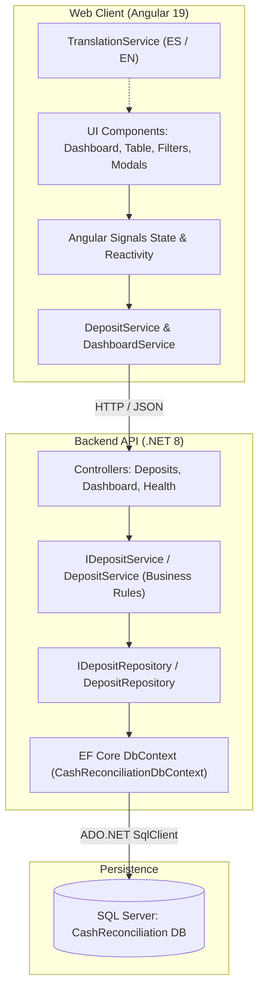

<p align="right">
  🇺🇸 English | <a href="README.es.md">🇪🇸 Español</a>
</p>

# Cash Reconciliation Portal

> 🚀 **Live / Online Demo**: You can run and test the application directly online at:  
> **[https://javtekoficial.github.io/Cash-Reconciliation-Portal/](https://javtekoficial.github.io/Cash-Reconciliation-Portal/)**

---

Enterprise-grade end-to-end system for managing, receiving, and reconciling store cash deposit bags at a central vault. Built with a decoupled, modern architecture featuring **ASP.NET Core Web API (.NET 8)**, **Entity Framework Core 8**, **SQL Server**, and an **Angular 19** web client with native multilingual support (**English** and **Spanish**).

---

## Table of Contents

1. [Overview & Objectives](#overview--objectives)
2. [Tech Stack](#tech-stack)
3. [System Architecture](#system-architecture)
4. [Business Rules](#business-rules)
5. [Prerequisites](#prerequisites)
6. [Installation & Setup](#installation--setup)
   - [1. Database Configuration](#1-database-configuration)
   - [2. Running the Backend (.NET 8 API)](#2-running-the-backend-net-8-api)
   - [3. Running the Frontend (Angular 19)](#3-running-the-frontend-angular-19)
7. [REST API Documentation](#rest-api-documentation)
8. [Automated Testing](#automated-testing)
9. [Internationalization & Multilingual Support (i18n)](#internationalization--multilingual-support-i18n)
10. [Project Structure](#project-structure)
11. [Git Commit History](#git-commit-history)

---

## Overview & Objectives

The portal addresses the operational need for cash intake control, verification, and auditability at central vaults:
* **Receipt & Registration**: Capture deposits with a unique bag/deposit number, store number, declared expected amount, and deposit date.
* **Counting & Reconciliation**: Input actual physical cash count with dynamic live variance calculation before submission.
* **Automated Audit**: Immediate classification into *Reconciled*, *Over*, or *Short* statuses based on detected differences.
* **Control Dashboard**: Consolidated real-time metrics (total deposits, pending, reconciled, short, over, and cumulative variance balance).
* **Advanced Search & Filters**: Search by deposit number, store number, status, and date range.
* **Server-Side Pagination**: Efficient database-level data segmentation with custom page sizing and navigation metadata.
* **Audit Trail**: Complete lifecycle traceability recording created, reconciled, and re-reconciled events with previous vs. new values, operator, and UTC timestamps.
* **CSV Export**: Server-side RFC 4180 compliant CSV export with active filters and UTF-8 BOM encoding for seamless Microsoft Excel compatibility.
* **Premium User Experience**: Modern light-theme interface with glassmorphism, micro-animations, fully responsive layout, and on-the-fly language switching (ES/EN).

---

## Tech Stack

| Layer | Technology | Version | Purpose |
| :--- | :--- | :--- | :--- |
| **Backend API** | ASP.NET Core Web API | .NET 8 | REST API with controllers and dependency injection |
| **ORM / Data** | Entity Framework Core | 8.0.11 | Relational data access, migrations, and Fluent API mapping |
| **Database** | Microsoft SQL Server / Express | 2019/2022 | Relational store with constraints and optimized indexes |
| **API Documentation** | Swagger / OpenAPI | Swashbuckle 6.6.2 | Interactive endpoint specification and testing |
| **Web Frontend** | Angular | 19.1 | SPA with Standalone Components, Signals, and Reactive Forms |
| **Styling** | Modern CSS3 | Custom tokens | CSS variables, Glassmorphism, light theme, and fluid micro-animations |
| **Backend Testing** | xUnit & Moq | 2.9 / 4.21 | Unit testing for business services, audit logging, and reconciliation rules |
| **Frontend Testing** | Jasmine & Karma | 5.5 / 6.4 | Unit testing for components, reactivity, modals, and translations |

---

## System Architecture

The system implements a decoupled layered architecture based on the **Repository Pattern**:



---

## Business Rules

### 1. Variance Calculation (Cash Discrepancy)
$$\text{Variance} = \text{Actual Amount Counted} - \text{Expected Amount}$$

### 2. Automatic Status Classification
* $\text{Variance} = 0 \longrightarrow$ **Reconciled (`Reconciled`)**: Counted cash matches the expected amount exactly.
* $\text{Variance} > 0 \longrightarrow$ **Over (`Over`)**: More cash was found in the bag than reported by the store.
* $\text{Variance} < 0 \longrightarrow$ **Short (`Short`)**: Less cash was found in the bag than reported by the store.

### 3. Integrity Validations
* `DepositNumber`: Mandatory, unique in the system (unique database index).
* `StoreNumber`: Mandatory (non-null, maximum length 50 characters).
* `ExpectedAmount`: Strictly greater than 0 (`> 0.00`).
* `ActualAmount`: Greater than or equal to 0 (`>= 0.00`) when reconciling.
* `DepositDate`: Valid deposit date.
* `ReconciledAt`: Automatic UTC timestamp recorded upon reconciliation.

---

## Prerequisites

Before running the application, ensure you have the following installed:
* [.NET 8 SDK](https://dotnet.microsoft.com/download/dotnet/8.0) (version 8.0.x or higher).
* [Node.js](https://nodejs.org/) (version 18.x or 20.x LTS) and `npm`.
* [Angular CLI](https://angular.dev/) (`npm install -g @angular/cli@19`).
* [Microsoft SQL Server](https://www.microsoft.com/sql-server/) (SQL Server Express, Developer, or LocalDB).
* Global EF Core CLI tools (optional, for manual migrations):
  ```bash
  dotnet tool install --global dotnet-ef
  ```

---

## Installation & Setup

### 1. Database Configuration

1. Open [BackEnd/appsettings.json](file:///c:/Users/Javie/Otros/Proyectos/Cash%20Reconciliation%20Portal/BackEnd/appsettings.json) and verify the connection string:
   ```json
   {
     "ConnectionStrings": {
       "DefaultConnection": "Server=localhost\\SQLEXPRESS;Database=CashReconciliation;Trusted_Connection=True;TrustServerCertificate=True;MultipleActiveResultSets=true"
     }
   }
   ```
   *(Adjust the server instance `Server=...` if your SQL Server instance differs from `localhost\SQLEXPRESS`).*

2. Apply Entity Framework Core migrations to create the database, tables, and seed initial records (*seed data*):
   ```powershell
   cd BackEnd
   dotnet ef database update
   ```

   **Automatically Seeded Initial Records:**
   | Deposit Number | Store | Expected Amount | Initial Status |
   | :--- | :--- | :--- | :--- |
   | `DEP1001` | `ST001` | $5,000.00 | Pending |
   | `DEP1002` | `ST002` | $4,250.00 | Pending |
   | `DEP1003` | `ST003` | $8,000.00 | Pending |
   | `DEP1004` | `ST004` | $1,200.00 | Pending |
   | `DEP1005` | `ST005` | $3,100.00 | Pending |

---

### 2. Running the Backend (.NET 8 API)

1. In a terminal, navigate to the `BackEnd` directory:
   ```powershell
   cd BackEnd
   dotnet run --launch-profile http
   ```
2. The API will be available at:
   * **Base URL**: `http://localhost:5017`
   * **Swagger UI (Interactive Docs)**: `http://localhost:5017/swagger`
   * **Health Check**: `http://localhost:5017/api/health`

---

### 3. Running the Frontend (Angular 19)

1. In a second terminal, navigate to the `FrontEnd` directory:
   ```powershell
   cd FrontEnd
   npm install
   npm start
   ```
2. Open your web browser at:
   * **Portal URL**: `http://localhost:4200`

---

## REST API Documentation

### Available Endpoints

| Method | Endpoint | Description | Response Codes |
| :--- | :--- | :--- | :--- |
| `GET` | `/api/health` | Service health status check | `200 OK` |
| `GET` | `/api/deposits` | Paginated & filtered list of deposits | `200 OK` |
| `GET` | `/api/deposits/{id}` | Get deposit details by ID | `200 OK`, `404 Not Found` |
| `GET` | `/api/deposits/{id}/audit-logs` | Chronological audit trail history | `200 OK`, `404 Not Found` |
| `GET` | `/api/deposits/export` | Export filtered search results to CSV (UTF-8 BOM) | `200 OK` |
| `POST` | `/api/deposits` | Register a new deposit into the vault | `201 Created`, `400 Bad Request` |
| `PUT` | `/api/deposits/{id}/reconcile` | Reconcile a deposit with counted actual amount | `200 OK`, `400 Bad Request`, `404 Not Found` |
| `GET` | `/api/dashboard` | Consolidated dashboard metrics (supports search filters) | `200 OK` |

### Query & Filter Parameters for `GET /api/deposits`

* `depositNumber` (string): Partial search by deposit number.
* `storeNumber` (string): Partial search by store number.
* `status` (string): Filter by status (`Pending`, `Reconciled`, `Over`, `Short`).
* `startDate` (DateTime): Minimum deposit date.
* `endDate` (DateTime): Maximum deposit date.
* `pageNumber` (int, default `1`, min `1`): Requested page number for server-side pagination.
* `pageSize` (int, default `10`, min `1`, max `100`): Number of records per page.

#### Paginated Response Structure (`PagedResult<DepositDto>`)
```json
{
  "items": [
    {
      "depositId": 1,
      "depositNumber": "DEP1001",
      "storeNumber": "ST001",
      "expectedAmount": 5000.00,
      "actualAmount": 5000.00,
      "variance": 0.00,
      "status": "Reconciled",
      "depositDate": "2026-10-23T04:00:00",
      "reconciledAt": "2026-10-23T04:30:00",
      "createdAt": "2026-10-23T04:00:00"
    }
  ],
  "pageNumber": 1,
  "pageSize": 10,
  "totalCount": 25,
  "totalPages": 3,
  "hasPreviousPage": false,
  "hasNextPage": true
}
```

### Request & Response Examples

#### 1. Register Deposit (`POST /api/deposits`)
**Request Body:**
```json
{
  "depositNumber": "DEP1006",
  "storeNumber": "ST006",
  "expectedAmount": 2500.00,
  "depositDate": "2026-10-23T10:00:00Z"
}
```
**Response (`201 Created`):**
```json
{
  "depositId": 6,
  "depositNumber": "DEP1006",
  "storeNumber": "ST006",
  "expectedAmount": 2500.00,
  "actualAmount": null,
  "variance": null,
  "status": "Pending",
  "depositDate": "2026-10-23T10:00:00",
  "reconciledAt": null,
  "createdAt": "2026-10-23T04:29:36.955Z"
}
```

#### 2. Reconcile Deposit (`PUT /api/deposits/{id}/reconcile`)
**Request Body:**
```json
{
  "actualAmount": 2450.00
}
```
**Response (`200 OK`):**
```json
{
  "depositId": 6,
  "depositNumber": "DEP1006",
  "storeNumber": "ST006",
  "expectedAmount": 2500.00,
  "actualAmount": 2450.00,
  "variance": -50.00,
  "status": "Short",
  "depositDate": "2026-10-23T10:00:00",
  "reconciledAt": "2026-10-23T04:31:14.519Z",
  "createdAt": "2026-10-23T04:29:36.955Z"
}
```

#### 3. Retrieve Audit Trail (`GET /api/deposits/{id}/audit-logs`)
**Response (`200 OK`):**
```json
[
  {
    "auditLogId": 2,
    "depositId": 6,
    "action": "Reconciled",
    "previousActualAmount": null,
    "newActualAmount": 2450.00,
    "previousVariance": null,
    "newVariance": -50.00,
    "previousStatus": "Pending",
    "newStatus": "Short",
    "performedBy": "Vault Operator",
    "notes": "Initial deposit reconciliation",
    "timestamp": "2026-10-23T16:30:00.000Z"
  },
  {
    "auditLogId": 1,
    "depositId": 6,
    "action": "Created",
    "previousActualAmount": null,
    "newActualAmount": null,
    "previousVariance": null,
    "newVariance": null,
    "previousStatus": null,
    "newStatus": "Pending",
    "performedBy": "Vault Operator",
    "notes": "Deposit registered with expected amount of $2,500.00",
    "timestamp": "2026-10-23T16:25:00.000Z"
  }
]
```

#### 4. Export to CSV (`GET /api/deposits/export`)
**Headers:**
```http
Content-Type: text/csv; charset=utf-8
Content-Disposition: attachment; filename="deposits_export_20261023_170000.csv"
```
**Response Body (UTF-8 BOM with headers and filtered records):**
```csv
Deposit Number,Store Number,Deposit Date,Expected Amount,Actual Amount,Variance,Status,Reconciled At,Created At
DEP1001,ST001,2026-10-23 04:00:00,5000.00,5000.00,0.00,Reconciled,2026-10-23 04:30:00,2026-10-23 04:00:00
DEP1002,ST002,2026-10-23 04:00:00,4250.00,,,Pending,,2026-10-23 04:00:00
```

#### 5. Dashboard Summary (`GET /api/dashboard`)
**Response (`200 OK`):**
```json
{
  "totalDeposits": 6,
  "pendingCount": 4,
  "reconciledCount": 1,
  "shortCount": 1,
  "overCount": 0,
  "totalVariance": -50.00,
  "totalExpectedAmount": 23050.00,
  "totalActualAmount": 2450.00
}
```

---

## Automated Testing

### Backend Unit Tests (xUnit + Moq)
The [BackEnd.Tests](file:///c:/Users/Javie/Otros/Proyectos/Cash%20Reconciliation%20Portal/BackEnd.Tests) project contains 14 comprehensive unit tests covering the service layer, reconciliation rules, audit logging, export, and pagination:
```powershell
dotnet test BackEnd.Tests/BackEnd.Tests.csproj
```
**Test Cases Covered:**
* Zero variance reconciliation $\rightarrow$ Status `Reconciled`.
* Overage reconciliation $\rightarrow$ Status `Over`.
* Shortage reconciliation $\rightarrow$ Status `Short`.
* Attempt to reconcile non-existent deposit $\rightarrow$ Returns `null`.
* Registration with duplicate deposit number $\rightarrow$ Throws `InvalidOperationException`.
* Valid registration $\rightarrow$ Persists with `Pending` status and audit fields.
* Consolidated dashboard metrics (global and with active filters).
* Deposit creation logs initial audit event (`Action = "Created"`).
* Initial reconciliation logs audit event (`Action = "Reconciled"`).
* Subsequent re-reconciliation logs audit event (`Action = "Re-Reconciled"`) capturing previous values.
* Retrieval of audit logs by deposit mapped to DTOs.
* CSV export with UTF-8 BOM encoding, standardized headers, and escaped special characters.
* Server-side pagination calculating `TotalCount`, `TotalPages`, next/prev flags, and `Skip/Take` slicing.

### Frontend Unit Tests (Angular + Jasmine)
The [FrontEnd](file:///c:/Users/Javie/Otros/Proyectos/Cash%20Reconciliation%20Portal/FrontEnd) project includes 23 unit tests executed with Karma and Headless Chrome:
```powershell
cd FrontEnd
npm test -- --watch=false --browsers=ChromeHeadless
```
Or validate TypeScript compilation and production packaging:
```powershell
cd FrontEnd
npm run build
```

---

## Internationalization & Multilingual Support (i18n)

The application supports **English** and **Spanish** (with Spanish as the initial default):
* **Reactive Architecture**: Built on Angular Signals (`currentLang = signal<SupportedLang>('es')`).
* **Template Translation**: Via `TranslatePipe` (`{{ 'DEPOSIT_NUMBER' | translate }}`).
* **Persistence**: User preference is stored in browser `localStorage`.
* **Complete Coverage**: Header text, KPI cards, filters, table columns, action buttons, statuses (`Pending / Pendiente`, `Reconciled / Conciliado`, etc.), pagination controls, and reactive validation messages.

---

## Project Structure

```text
Cash Reconciliation Portal/
├── .gitignore
├── README.md                                 # English documentation
├── README.es.md                              # Spanish documentation
├── BackEnd/                                  # ASP.NET Core Web API Project (.NET 8)
│   ├── CashReconciliation.Api.csproj
│   ├── Program.cs                            # Service configuration, CORS, Swagger, DI
│   ├── appsettings.json                      # Connection strings and configuration
│   ├── Controllers/
│   │   ├── DashboardController.cs            # Aggregate KPI metrics
│   │   ├── DepositsController.cs             # Deposit CRUD, reconciliation, export & audit
│   │   └── HealthController.cs               # System health check
│   ├── Data/
│   │   └── CashReconciliationDbContext.cs    # EF Core DbContext, Fluent API & Seed Data
│   ├── DTOs/                                 # Request and response contracts (PagedResult, etc.)
│   ├── Migrations/                           # EF Core migrations
│   ├── Models/                               # Domain entities (Deposit, DepositAuditLog)
│   ├── Repositories/                         # Data access layer
│   │   ├── IDepositRepository.cs
│   │   └── DepositRepository.cs
│   └── Services/                             # Business logic and reconciliation rules
│       ├── IDepositService.cs
│       └── DepositService.cs
├── BackEnd.Tests/                            # xUnit Unit Testing Suite (.NET 8)
│   ├── BackEnd.Tests.csproj
│   └── DepositServiceTests.cs                # Moq unit tests
└── FrontEnd/                                 # Angular 19 SPA Application
    ├── angular.json
    ├── package.json
    ├── src/
    │   ├── index.html                        # Outfit & Plus Jakarta Sans typography
    │   ├── styles.css                        # Global tokens, glassmorphism, modern light design
    │   └── app/
    │       ├── app.component.ts              # Main logic, Signals, pagination & modals
    │       ├── app.component.html            # Semantic and responsive layout template
    │       ├── app.component.css             # Component styles and micro-animations
    │       ├── app.component.spec.ts         # Component unit tests (23 tests)
    │       ├── i18n/
    │       │   └── translations.ts           # Bilingual dictionaries (EN / ES)
    │       ├── models/
    │       │   └── deposit.model.ts          # TypeScript strict typing & interfaces
    │       ├── pipes/
    │       │   └── translate.pipe.ts         # Reactive i18n pipe
    │       └── services/
    │           ├── dashboard.service.ts      # HTTP client for dashboard metrics
    │           ├── deposit.service.ts        # HTTP client for deposits
    │           └── translation.service.ts    # Reactive i18n service
```

---

## Git Commit History

Maintained according to the *Conventional Commits* specification:

1. `feat(backend): initialize .NET 8 Web API project and implement health check endpoint`
2. `feat(backend): configure ef core, sql server context, migrations and seed data`
3. `feat(backend): implement repository pattern, business logic and rest controllers`
4. `feat(frontend): initialize angular app with i18n translation service and http clients`
5. `feat(frontend): implement dashboard, deposit table, search filters and modals`
6. `docs: add comprehensive project documentation, test suite and setup guide`
7. `feat(audit): implement deposit audit trail logging, rest endpoint and ui timeline`
8. `feat(export): implement server-side csv export with active filters and frontend download`
9. `feat(pagination): implement server-side pagination with controls and paged results`
